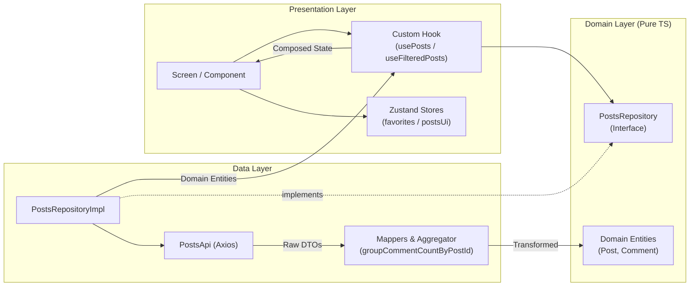

<!--
  Developer: CORZ (https://www.linkedin.com/in/omar-ramirez-6a51b7141/)
  Date: 2026-10-12
  Description: Posts App Technical Documentation and Architecture Guide
-->

# 📱 Posts App

> A production-ready, clean-architecture mobile application built with **React Native**, **Expo (CNG)**, **TypeScript**, **TanStack Query**, **Zustand**, and **NativeWind v4**.

---

## 📸 Overview & Preview

The **Posts App** is a responsive, modern feed application that fetches and visualizes posts and comments from the JSONPlaceholder REST API. Designed with a dark glassmorphic design system, tactile micro-animations, and strict architectural boundaries, the app prioritizes performance, accessibility, and maintainability.

```
┌─────────────────────────────────────────────────────────────────┐
│                        POSTS APP PREVIEW                        │
│                                                                 │
│   [ Posts & Feed ]                          [ Post Detail ]     │
│   ┌───────────────────────────┐      ┌────────────────────────┐ │
│   │ 🔍 Search posts...    [✕] │      │ ← Back             ⭐  │ │
│   └───────────────────────────┘      ├────────────────────────┤ │
│   ┌─────────────┬─────────────┐      │ Author ID: #1          │ │
│   │  All (100)  │ ⭐ Favs (3) │      │ sunt aut facere...     │ │
│   └─────────────┴─────────────┘      │ quia et suscipit...    │ │
│   ┌───────────────────────────┐      ├────────────────────────┤ │
│   │ User #1               ⭐  │      │ Comments (5)           │ │
│   │ sunt aut facere...        │      │ ┌────────────────────┐ │ │
│   │ quia et suscipit...       │      │ │ 👤 id labore...    │ │ │
│   │ 💬 5 comments             │      │ │    Eliseo@gardner  │ │ │
│   └───────────────────────────┘      │ └────────────────────┘ │ │
└─────────────────────────────────────────────────────────────────┘
```

---

## 🛠️ Tech Stack & Technical Rationale

| Technology | Selection Rationale |
| :--- | :--- |
| **Expo SDK 52+ (CNG)** | Continuous Native Generation avoids committing brittle `android/` and `ios/` folders while enabling full native module access via development builds (`expo-dev-client`). |
| **TypeScript (Strict)** | Eliminates runtime bugs with strict null checks, no `any`, and full compile-time validation of DTOs, domain models, and store states. |
| **Expo Router** | Modern, declarative, file-based routing with deep linking support and route params typing. Routes remain ultra-thin adapters. |
| **TanStack Query v5** | Industry standard for server-state caching, automatic background revalidation, query key factories, and parallel request coordination (`useQueries`). |
| **Zustand v5** | Lightweight client-state management with granular selectors and `persist` middleware for local storage. Never duplicates server cache. |
| **NativeWind v4 (Tailwind)** | Compile-time CSS-in-JS utility styles via Tailwind CSS engine, mapped to React Native StyleSheet bridge with zero runtime overhead. |
| **Axios** | Single, robust HTTP client with custom interceptor for error normalization and uniform API client behavior. |
| **AsyncStorage** | Cross-platform persistent key-value storage behind a typed adapter for favorite posts. |
| **Jest & Testing Library** | Unit testing for mappers, comment aggregation selectors, Zustand stores, and filtering hooks. |

---

## 🏛️ Clean Architecture

The project follows a pragmatic **Feature-Module Clean Architecture** governed by the **Dependency Inversion Principle**:

```
Presentation Layer (UI, Screens, Hooks, Stores)
       ↓ (depends on)
 Domain Layer (Entities, Repository Interface)  ← Zero Framework Imports
       ↑ (implements)
   Data Layer (API Clients, DTOs, Mappers, Repository Implementation)
```

### 📂 Directory Structure

```
posts-app/
├── src/
│   ├── app/                                 # Expo Router (thin route adapters)
│   │   ├── _layout.tsx                      # Root provider stack (QueryClient, Fonts, Theme)
│   │   ├── index.tsx                        # Posts list route entry
│   │   └── posts/
│   │       └── [id].tsx                     # Post detail route entry
│   │
│   ├── core/                                # Infrastructure concerns
│   │   ├── api/                             # Axios client & error normalizer
│   │   ├── config/                          # Base URLs and query constants
│   │   ├── query/                           # TanStack QueryClient instance & defaults
│   │   ├── storage/                         # AsyncStorage adapter for Zustand persist
│   │   └── theme/                           # Design tokens (Colors, Typography, Spacing)
│   │
│   ├── shared/                              # Cross-feature reusable building blocks
│   │   ├── components/                      # Screen, SkeletonCard, ErrorState, EmptyState
│   │   ├── hooks/                           # useDebounce
│   │   └── utils/                           # strings, formatters
│   │
│   └── modules/
│       └── posts/                           # Feature Module: Posts
│           ├── domain/                      # Core business models & contracts
│           │   ├── entities.ts              # Post, Comment, CommentCountMap
│           │   └── PostsRepository.ts       # Interface boundary (no framework code)
│           │
│           ├── data/                        # Concrete data fetching & mapping
│           │   ├── dtos.ts                  # Raw API payload contracts
│           │   ├── mappers.ts               # DTO → Domain Entity transforms
│           │   ├── PostsApi.ts              # Axios network requests
│           │   └── PostsRepositoryImpl.ts   # Repository contract implementation
│           │
│           └── presentation/                # UI and presentation logic
│               ├── components/              # PostCard, PostList, FilterTabs, SearchBar, CommentItem, FavoriteButton
│               ├── hooks/                   # usePosts, useFilteredPosts, usePostComments, queryKeys
│               ├── screens/                 # PostsListScreen, PostDetailScreen
│               └── store/                   # postsUiStore, favoritesStore
```

### 🔄 Data Flow Diagram (Mermaid)



---

## 🎨 Design System & Tokens

All visual tokens are defined in **`src/core/theme/tokens.ts`** and consumed in two synchronized ways:

1. **Tailwind Config (`tailwind.config.js`)**: Injects semantic color variables (`bg-primary`, `bg-secondary`, `text-primary`, `border-border`, etc.) directly into NativeWind utility classes.
2. **TypeScript Runtime**: Provides exact hex codes for native APIs that cannot take class names, such as `StatusBar` background, `ActivityIndicator` tint, and `RefreshControl` spinner colors.

### Core Color Palette

- **Background Deep**: `#0F0F1A`
- **Background Secondary / Glass**: `#161627`
- **Primary Indigo Accent**: `#6C63FF`
- **Secondary Teal Accent**: `#00D4AA`
- **Text Primary**: `#F0F0FF`
- **Text Secondary**: `#A8A8C8`
- **Borders**: `#2A2A4A`

---

## ⚡ State Management & Key Architecture Trade-offs

### 1. Server State vs. Client State Separation
- **TanStack Query** manages **server state**: caching, background re-fetching, and error retries. Server state is never duplicated in Zustand.
- **Zustand** manages **client state**:
  - `postsUiStore`: Ephemeral UI state (search input query, active filter tab). Resets between sessions.
  - `favoritesStore`: Persisted state (favorited post IDs Set). Backed by `AsyncStorage` and survives restarts.

### 2. Eliminating the N+1 Comment Count Problem
- Fetching comments individually for 100 posts would trigger 100 separate HTTP requests ($O(N)$ HTTP overhead).
- Instead, the app fetches `GET /comments` **once** and passes it to the pure function `groupCommentCountByPostId` which computes a `Record<postId, count>` in a single $O(M)$ pass.
- `usePosts()` parallelizes the posts and comments requests via `useQueries()`, cutting initial network load time in half.

### 3. Client-Side Debounced Filtering
- Search and favorites filtering run in memory over the cached posts array in `useFilteredPosts`.
- The `SearchBar` employs a 300ms debounce to prevent layout thrashing on every keystroke while ensuring typing remains silky-smooth.

---

## 🧪 Testing Suite

The project includes a suite of focused unit tests covering data transformations, state transitions, and filtering logic:

```bash
npm test
```

### Test Coverage Highlights
- **`mappers.test.ts`**: Verifies DTO-to-entity mapping and $O(M)$ comment-count aggregation.
- **`favoritesStore.test.ts`**: Verifies toggle logic, idempotency, set mutations, and persistence isolation.
- **`filterLogic.test.ts`**: Tests case-insensitive search by title and body, tab filters, and combined edge cases.

---

## 🚀 How to Run the App

### 1. Installation

```bash
# Clone the repository and install dependencies
git clone <repository-url>
cd posts-app
npm install
```

### 2. Quality Verification Commands

```bash
# Type check with strict TypeScript compiler
npm run type-check

# Run ESLint across codebase
npm run lint

# Run Jest unit test suite
npm test
```

### 3. Launching Independent Development Build (Without Expo Go)

Per strict production constraints, the app is configured for standalone execution via **Expo Prebuild & Dev Client**:

```bash
# Android Development Build
npx expo run:android

# iOS Development Build (macOS with Xcode)
npx expo run:ios
```

To run with Metro bundler:
```bash
npm start
```

---

## 🔮 Possible Improvements & Next Steps

1. **Offline Persistence for Queries**: Add TanStack Query's `persistQueryClient` with an AsyncStorage persister to allow offline post browsing.
2. **Infinite Pagination**: If JSONPlaceholder supported cursor/page limits (`_page`, `_limit`), convert `usePosts` to `useInfiniteQuery`.
3. **Share Intent**: Allow native sharing of post links or text using React Native's `Share` API.
4. **E2E Testing**: Add Detox or Maestro automated flows verifying the complete list-to-detail interaction.
